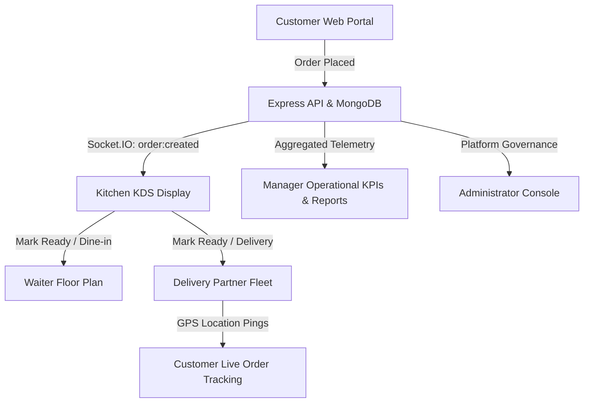

# FoodFlow Pro - Smart Restaurant Operations & Logistics Platform

[](https://nodejs.org/)
[](https://react.dev/)
[](https://expressjs.com/)
[](https://mongoosejs.com/)
[](https://socket.io/)
[](https://opensource.org/licenses/MIT)

**FoodFlow Pro** is an enterprise-grade restaurant operations and real-time food delivery ecosystem. It connects customers, waitstaff, kitchen operators, delivery fleets, restaurant managers, and platform administrators through a unified database architecture and high-frequency WebSocket channels.

---

## 📑 Table of Contents
- [System Architecture & Flow](#-system-architecture--flow)
- [Key Features by Role](#-key-features-by-role)
- [Tech Stack](#-tech-stack)
- [Project Structure](#-project-structure)
- [Quick Start & Installation](#-quick-start--installation)
- [Demo Credentials & 1-Click Role Switcher](#-demo-credentials--1-click-role-switcher)
- [API Route Reference](#-api-route-reference)
- [Real-Time Socket.IO Channels](#-real-time-socketio-channels)
- [Automated Testing Suite](#-automated-testing-suite)

---

## 🏛 System Architecture & Flow



1. **Customer Places Order**: Customer chooses Dine-In (with table occupancy) or Delivery. Subtotal and 5% GST are calculated instantly.
2. **Kitchen Receives Ticket**: Real-time incoming ticket arrives on the KDS sorted FIFO with dynamic elapsed timers.
3. **Dispatch & Service**:
   - **Dine-in**: Marked `Ready` → Alerts assigned table on waiter visual floor plan. Waiter serves food and settles bill.
   - **Delivery**: Marked `Ready` → Emits to delivery fleet. Driver claims, transitions order to `Out for Delivery`, and streams live GPS telemetry.
4. **Operations & Governance**: Manager monitors live revenue, occupied tables, and menu stock. Admin governs restaurant onboarding, user roles, and customer dispute arbitrations.

---

## 🚀 Key Features by Role

### 1. 🍽️ Customer Journey (`/`, `/menu`, `/cart`, `/checkout`, `/track/:orderId`)
- **Restaurant Discovery**: Browse by cuisine (*Italian, Indian, Pizza, Mains*) and real-time search.
- **Menu Customization**: Item category browsing, price formatting, and special preparation instructions.
- **Dual Checkout Modes**:
  - **Dine-In**: Select table (1–10) with automatic occupancy reservation.
  - **Delivery**: Delivery address and contact input with automatic driver dispatching.
- **Payment Methods**: Card, UPI, or Cash-on-Delivery.
- **Live Order Tracking**: Dynamic 4-stage stepper (`Confirmed` → `Preparing` → `Out for Delivery` → `Delivered`) with live GPS ping coordinates.

### 2. 👨‍🍳 Kitchen Display System - KDS (`/kitchen`)
- **Live Ticket Feed**: Real-time ticket queue organized chronologically (FIFO).
- **Elapsed Timers**: Visual time-since-order badges (`10m 15s`) to prioritize orders.
- **State Transitions**: `Pending` → `Preparing` → `Ready`.
- **Sound Alerts**: Web Audio API crystal chime notifications on new tickets and status changes.

### 3. 🤵 Waiter Table Service (`/waiter`)
- **10-Table Visual Floor Plan**: Real-time floor layout indicating table capacity, occupancy, and status (*Available, Occupied, Reserved*).
- **Food Ready Banner**: High-priority alert banner when kitchen marks dine-in tickets as ready.
- **Bill Settlement**: 1-click POS payment processing, bill printout layout, and table turnover release.

### 4. 🛵 Delivery Fleet Logistics (`/delivery`)
- **Driver Order Board**: Claim available orders ready for delivery.
- **Lifecycle Management**: `Assigned` → `Picked Up` → `Out for Delivery` → `Delivered`.
- **Live GPS Simulation**: Emits real-time latitude/longitude coordinates (`12.9716, 77.5946`) with speed and heading metrics over WebSockets.

### 5. 📊 Manager Dashboard (`/manager`)
- **Tab 1: Operational KPIs**:
  - Today's Revenue ($) and Month Revenue ($) with percentage trend indicators.
  - Active occupied tables count (`4 / 10 Tables`).
  - Average preparation turnaround time (min) and delivery turnaround time.
  - CSS-based category revenue breakdown charts & top-selling dish leaderboard.
- **Tab 2: Menu Management (Full CRUD)**:
  - Searchable table of dishes with category filters.
  - **"Add New Dish"** & **"Edit Dish"** modals with full input validation.
  - **Instant Availability Toggle**: Quick switch between *In Stock* and *Out of Stock* with immediate socket sync to customer menus.
  - Delete dish confirmation.
- **Tab 3: Live Operations Monitor**: Real-time cross-system table of dine-in and delivery orders with order inspection and cancellation.
- **Tab 4: Sales & Operations Reports**: Filter by *Today, This Week, This Month*, summary financials, daily sales breakdown, **CSV export**, and **Print Report** formatting.

### 6. 🛡️ Administrator Console (`/admin`)
- **Platform Telemetry**: Total platform GMV, registered customer count, active staff breakdown, database status, and API response latency.
- **Restaurant Partner Management**: Onboard new restaurants, view partner GMV, and toggle operational status (Open/Closed).
- **User Role Switcher**: Searchable user table with interactive role dropdown (*Customer, Waiter, Kitchen, Delivery, Manager, Admin*).
- **Customer Disputes & Moderation**: Arbitrate refund requests, quality complaints, delivery delays, and moderate inappropriate reviews.

---

## 🛠 Tech Stack

| Layer | Technologies |
|---|---|
| **Frontend** | React.js 18, React Router v6, Lucide React, Web Audio API, Vanilla CSS (Glassmorphism & Dark Mode) |
| **Backend** | Node.js, Express.js, RESTful Architecture |
| **Database** | MongoDB, Mongoose 7 ORM |
| **Real-Time** | Socket.IO 4.7 (Rooms, Role Broadcasts, Bidirectional Events) |
| **Security** | JWT (JSON Web Tokens), bcrypt.js password hashing, Role-Based Access Control (`authorize`) |

---

## 📂 Project Structure

```text
FoodFlowPro/
├── backend/
│   ├── config/             # Database connection (MongoDB)
│   ├── controllers/        # Business logic controllers
│   │   ├── adminController.js      # Platform stats, restaurant onboarding, role switcher, disputes
│   │   ├── authController.js       # Register, login, me
│   │   ├── deliveryController.js   # Delivery fleet claims & coordinates
│   │   ├── kitchenController.js    # KDS ticket states & timers
│   │   ├── managerController.js    # Operational KPIs, Menu CRUD, reports
│   │   ├── orderController.js      # Order creation, calculation, checkout
│   │   ├── restaurantController.js # Public restaurants and menu queries
│   │   ├── reviewController.js     # Customer reviews and ratings
│   │   └── waiterController.js     # Table floor plan & bill settlement
│   ├── middleware/         # JWT protection & role authorization middleware
│   ├── models/             # Mongoose Schemas (User, Order, MenuItem, Table, Delivery, Restaurant, Review, Dispute)
│   ├── routes/             # Express API routes
│   ├── socket/             # Socket.IO room setup & programmatic broadcast helpers
│   ├── utils/              # Database seeder (seedData.js)
│   ├── run_all_tests.js    # Unified test runner
│   ├── server.js           # Server entry point
│   └── package.json
│
├── frontend/
│   ├── src/
│   │   ├── components/     # Header (with Role Switcher), AccessDenied, Modals
│   │   ├── context/        # AuthContext, CartContext, SocketContext
│   │   ├── pages/          # Home, RestaurantMenu, Cart, Checkout, CustomerOrders,
│   │   │                   # KitchenDashboard, WaiterDashboard, DeliveryDashboard,
│   │   │                   # OrderTracking, ManagerDashboard, AdminDashboard, Login, Register
│   │   ├── styles/         # Comprehensive design system (main.css)
│   │   ├── App.js          # Route definitions & RoleRoute protection
│   │   └── index.js
│   └── package.json
└── README.md
```

---

## ⚡ Quick Start & Installation

### Prerequisites
- [Node.js](https://nodejs.org/) (v16 or higher)
- [MongoDB](https://www.mongodb.com/) (running locally or MongoDB Atlas URI)

### 1. Clone the Repository
```bash
git clone https://github.com/rohith-1205/FoodFlowPro.git
cd FoodFlowPro
```

### 2. Configure Backend Environment
Create a `.env` file in `/backend`:
```env
PORT=5000
MONGO_URI=mongodb://localhost:27017/foodflowpro
JWT_SECRET=foodflow_secret_key
```

### 3. Install & Start Backend
```bash
cd backend
npm install
npm run seed     # Seeds demo users, restaurants, menu items, tables & disputes
npm run dev      # Starts server on http://localhost:5000
```

### 4. Install & Start Frontend
In a new terminal window:
```bash
cd frontend
npm install
npm start        # Launches client on http://localhost:3000
```

---

## 🔑 Demo Credentials & 1-Click Role Switcher

For evaluation, testing, or demonstrations, use the interactive **"Role: [Role Name]"** dropdown in the navigation header. Alternatively, sign in using the following accounts (all passwords are `password123`):

| Role | Demo Email | Password | Default Workspace |
|---|---|---|---|
| **Customer** | `customer@foodflow.com` | `password123` | Customer Menu & Orders (`/menu`) |
| **Waiter** | `waiter@foodflow.com` | `password123` | Waiter Table Plan (`/waiter`) |
| **Kitchen** | `kitchen@foodflow.com` | `password123` | Kitchen KDS Screen (`/kitchen`) |
| **Delivery** | `delivery@foodflow.com` | `password123` | Delivery Portal (`/delivery`) |
| **Manager** | `manager@foodflow.com` | `password123` | Manager Dashboard (`/manager`) |
| **Admin** | `admin@foodflow.com` | `password123` | Administrator Console (`/admin`) |

---

## 📡 API Route Reference

### Authentication (`/api/auth`)
- `POST /register` - Register a new user account
- `POST /login` - Sign in and receive JWT token
- `GET /me` - Retrieve authenticated user profile

### Customer Ordering & Menus
- `GET /api/restaurants` - List partner restaurants (supports `?search=`)
- `GET /api/restaurants/:id/menu` - Fetch restaurant menu grouped by category
- `POST /api/orders` - Place dine-in or delivery order
- `GET /api/orders/my-orders` - Fetch authenticated customer order history
- `GET /api/orders/:id` - Fetch order ticket by ID

### Kitchen Operations (`/api/kitchen` - Protected: Kitchen, Manager, Admin)
- `GET /orders` - Fetch all active tickets with elapsed preparation timers
- `PATCH /orders/:id/status` - Transition status (`Preparing` / `Ready`)

### Waiter Service (`/api/waiter` - Protected: Waiter, Manager, Admin)
- `GET /tables` - List all 10 floor tables with occupancy and food readiness
- `POST /orders` - Place POS table order directly from floor
- `POST /settle` - Process bill payment and release table back to available

### Delivery Logistics (`/api/delivery` - Protected: Delivery, Manager, Admin)
- `GET /available` - List ready delivery orders
- `PATCH /:id/claim` - Assign delivery agent to order
- `PATCH /:id/status` - Transition delivery status (`Picked Up`, `Out for Delivery`, `Delivered`)
- `POST /:id/location` - Broadcast current GPS coordinates

### Manager Dashboard (`/api/manager` - Protected: Manager, Admin)
- `GET /kpis` - Operational KPIs (today/monthly revenue, prep turnaround, top dishes)
- `GET /menu` - Fetch menu catalogue with category and search filters
- `POST /menu` - Create new dish
- `PUT /menu/:id` - Edit dish details and price
- `DELETE /menu/:id` - Delete dish
- `PATCH /menu/:id/toggle` - Quick in-stock / out-of-stock toggle
- `GET /live-orders` - Real-time cross-system orders monitor
- `PATCH /orders/:id/status` - Manager order cancellation or status update
- `GET /reports` - Sales financial summary grouped by date and category

### Administrator Console (`/api/admin` - Protected: Admin)
- `GET /restaurants` & `POST /restaurants` - List and onboard partner restaurants
- `PUT /restaurants/:id` & `PATCH /restaurants/:id/toggle` - Edit partner or toggle open/closed
- `GET /users` - List registered users with role filter
- `PATCH /users/:id/role` - Switch user role (`customer`, `waiter`, `kitchen`, `delivery`, `manager`, `admin`)
- `GET /disputes` & `PATCH /disputes/:id` - Arbitrate complaints and approve refunds
- `DELETE /reviews/:id` - Moderate inappropriate customer reviews
- `GET /stats` - Platform-wide GMV, telemetry, and system infrastructure health

---

## 🔄 Real-Time Socket.IO Channels

| Event Name | Direction | Payload | Description |
|---|---|---|---|
| `order:created` | Server → Kitchen, Manager | Order Object | Alerts kitchen and manager of a new incoming order |
| `order:status_update` | Server → Client / Roles | Order & Status | Broadcasts state transitions (`Preparing`, `Ready`, etc.) |
| `table:ready` | Server → Waiter, Manager | Table Number & Items | Triggers ready food alert on Waiter visual floor plan |
| `order:ready_for_delivery` | Server → Delivery Fleet | Delivery Ticket | Notifies delivery fleet of food ready for pickup |
| `delivery:location_ping` | Client ↔ Server → Customer | GPS Lat/Lng & Telemetry | Live coordinate stream to customer tracking page |
| `menu_updated` | Server → Clients | Action & Item | Notifies active customer sessions of dish stock toggles |

---

## 🧪 Automated Testing Suite

FoodFlow Pro features comprehensive test coverage covering model schemas, role authorizations, financial math, KDS turnaround timers, and socket helpers:

```bash
cd backend
npm test
```

### Test Suites Included:
- **Core Logic Suite (Dev 1)**: Password hashing, JWT verification, role authorization middleware, 5% GST tax calculation.
- **KDS & Waiter Suite (Dev 2)**: Kitchen role isolation, elapsed time formatting, POS bill math, payment method mappings.
- **Delivery & Socket Suite (Dev 3)**: Delivery schema validations, GPS coordinates, distance computations, socket room formatters.
- **Manager & Admin Suite (Dev 4)**: Dispute models, manager KPI aggregations, full menu CRUD validations, user role switcher.

```text
====================================================
       FOODFLOW PRO - FULL TEST RUNNER             
====================================================
✅ Core Logic Tests:           22 Passed, 0 Failed
✅ KDS & Waiter Tests:         13 Passed, 0 Failed
✅ Delivery & Socket Tests:    30 Passed, 0 Failed
✅ Manager & Admin Tests:      47 Passed, 0 Failed
====================================================
🎉 ALL 112 TESTS PASSED!
```

---

## 👥 Contributors
Developed by:
- **Rohith** (Developer 4 - Manager Dashboard, Menu CRUD, Admin Console & Navigation)
- **Dharun** (Developer 2 - Kitchen KDS, Waiter Service & Table Plan)
- **Sanjay Krishnaa** (Developer 3 - Delivery Partner Fleet & Live GPS Telemetry)
- **Vishwajith** (Developer 1 - Core Models, Restaurant Menus & Customer Ordering)

---

## 📄 License
This project is licensed under the [MIT License](LICENSE).
